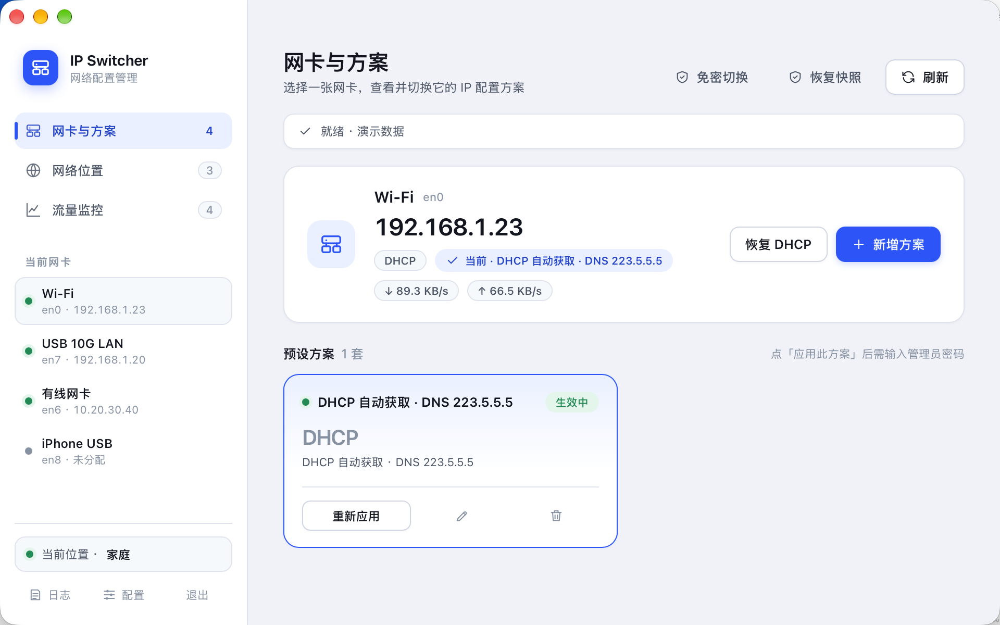
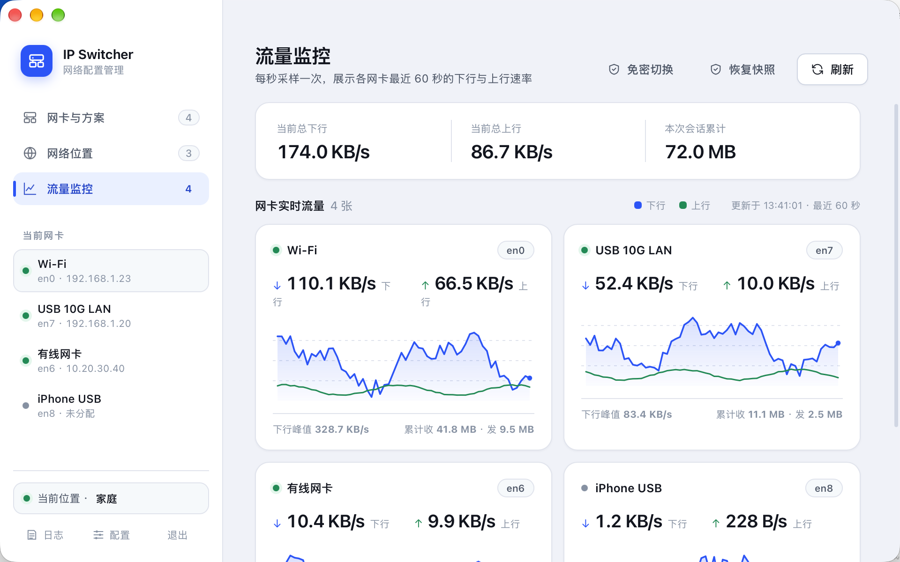
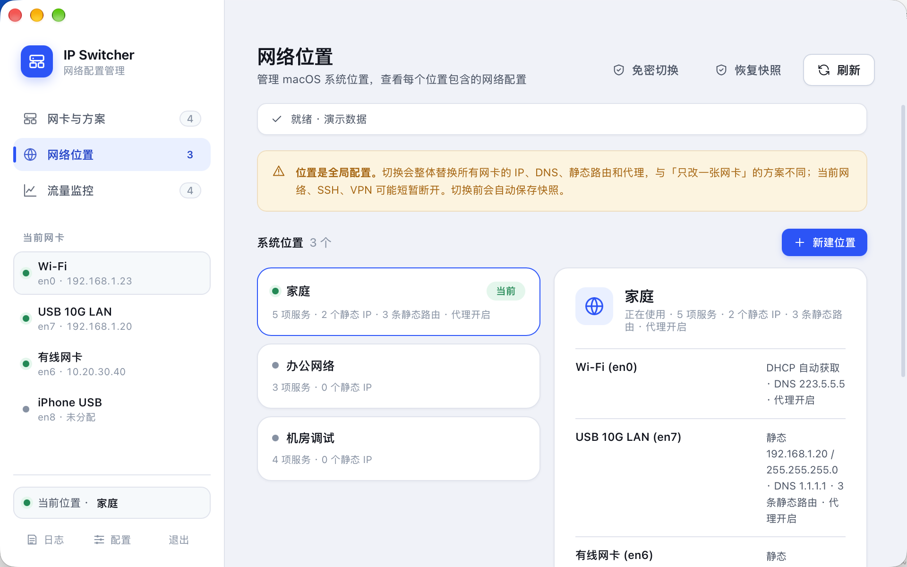
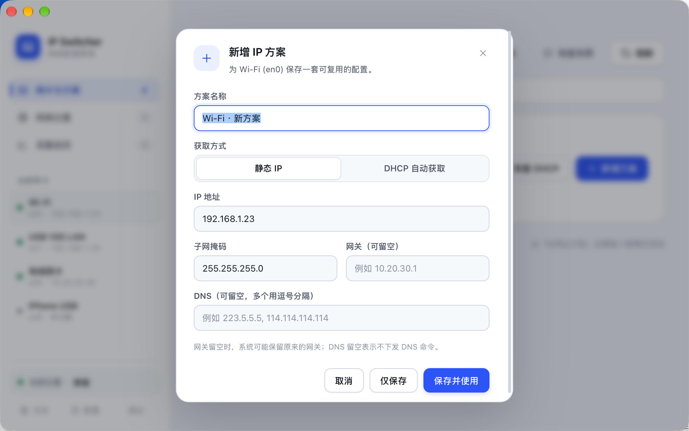

# ip-switcher

[English](README.en.md) | 简体中文

一个 macOS 网卡 IP 切换工具：为每张网卡保存多套预设方案（静态 IP / DHCP），一键切换、新增、编辑，并附带实时流量监控。

适合需要在多个网络环境（办公网、机房、实验室、内网调试）之间频繁切换 IP 的开发者与运维人员。

## 界面预览

| 网卡与方案 | 流量监控 |
|---|---|
|  |  |
| **网络位置** | **新增方案** |
|  |  |

## 快速上手（TL;DR）

**改了代码后怎么启动：**

```bash
cd ip-switcher
swift build --disable-sandbox -c debug
.build/debug/IPSwitcher        # 开发调试，关窗口即退出，改完重跑即可
```

要打包成正式 App 则运行 `./build.sh`，然后双击 `IPSwitcher.app`。

**怎么安装使用：**

- 自己用：`./build.sh` 构建后，双击 `IPSwitcher.app` 即可，无任何安装步骤（放「应用程序」文件夹更整洁）
- 给别人用：把 `IPSwitcher.app` 压缩成 zip 发给对方；对方解压后**右键 → 打开**放行一次（ad-hoc 签名首次会被 Gatekeeper 拦），之后正常双击。若仍打不开，执行 `xattr -dr com.apple.quarantine /Applications/IPSwitcher.app`

更多细节见下文与 [文档](#文档)。

## 文档

- [开发指南](docs/DEVELOPMENT.md)：环境准备、调试运行、代码结构、自检与日志
- [发布与安装](docs/RELEASE.md)：构建发布包、签名与公证、DMG 打包、他人如何安装

## 功能

- **方案切换**：每张网卡可保存多套预设方案，点击即应用，当前生效的方案自动打 ✓
- **新增 / 编辑 / 删除**：模态表单编辑静态 IP、子网掩码、网关、DNS，保存前自动校验格式
- **一键恢复 DHCP**：不想再手动配时，一键回到自动获取
- **网络位置管理**：浏览 macOS 系统网络位置，可将现有位置的配置一键导入为方案
- **实时流量监控**：每张网卡的上下行速率曲线（60 秒窗口）、累计流量与峰值；未连接的接口明确标注
- **免密切换（可选）**：一次授权写入 sudoers 规则后，切换、恢复 DHCP 均不再弹密码框；规则只对 `networksetup` 生效，可随时一键撤销
- **精确回滚**：应用失败或用户取消时自动回滚，且回滚严格镜像本次实际下发的命令，不会"多恢复"
- **快照恢复**：每次修改前自动备份配置文件，随时可回退

## 安全设计

- 所有网络命令通过 `networksetup` 标准接口下发，**绝不拼接 shell 字符串**
- 修改前生成系统快照；应用失败自动回滚到修改前的状态
- 修改 IPv4 / DNS 前自动备份 `profiles.json`，删除方案、编辑方案同样有备份
- 应用过程只需**一次**管理员授权（密码），授权窗口内完成下发、校验与（必要时）回滚
- 可选的「免密切换」开关会往 `/etc/sudoers.d/ipswitcher` 写入仅覆盖 `/usr/sbin/networksetup` 的 NOPASSWD 规则；写入前经 `visudo` 语法校验，关闭开关即删除规则

## 构建

要求：macOS 13+、Swift 5.9+（Xcode 或 Swift 工具链）。

```bash
git clone https://github.com/PLAhui/ip-switcher.git
cd ip-switcher
./build.sh
```

脚本会依次完成：生成默认配置（仅首次）→ Release 编译 → 组装 `IPSwitcher.app` → 打包 Web 资源 → ad-hoc 签名。

分发用的通用二进制与版本号：

```bash
UNIVERSAL=1 VERSION=1.0.0 ./build.sh   # 同时支持 Apple Silicon 与 Intel
```

签名、公证、DMG 打包见 [发布与安装](docs/RELEASE.md)。

构建产物：

| 产物 | 说明 |
|---|---|
| `IPSwitcher.app` | 主应用，双击运行 |
| `.build/release/ipswctl` | 命令行工具 |

## 使用

打开 `IPSwitcher.app`，左侧分三页：

1. **网卡与方案** — 左侧选择网卡，右侧是该网卡的方案列表；点「应用此方案」输一次密码即生效。没有符合的预设时点「+ 新增方案」，填好 IP 后可选「仅保存」或「保存并使用」。
2. **网络位置** — 查看 / 切换系统网络位置，或把位置的当前配置导入为方案（一般用不到，主要作为数据源）。
3. **流量监控** — 查看每张网卡的实时速率曲线。

应用是普通 App：启动即开主窗口，**关闭窗口即退出**，不在后台常驻。

## 命令行工具 ipswctl

```bash
.build/release/ipswctl list              # 列出全部预设
.build/release/ipswctl state             # 当前网卡状态与方案匹配情况
.build/release/ipswctl preview <方案ID>   # 预演将要执行的命令（不实际执行）
.build/release/ipswctl script <方案ID>    # 导出提权脚本
.build/release/ipswctl apply <方案ID>     # 应用方案
.build/release/ipswctl locations         # 系统网络位置列表
```

## 配置文件

预设方案保存在 `~/Library/Application Support/IPSwitcher/profiles.json`。

该文件由首次构建时的 `ipswctl init-config` 根据当前系统的网卡与网络位置自动生成，**不入库**（避免泄漏个人网络信息）。核心结构：

```jsonc
{
  "profiles": [
    {
      "id": "plan-en0-192-168-1-50",
      "name": "办公网",
      "services": [{
        "match": { "device": "en0", "serviceName": "Wi-Fi" },
        "ipv4": { "mode": "manual", "ip": "192.168.1.50",
                  "mask": "255.255.255.0", "router": "192.168.1.1" },
        "dns": { "servers": ["223.5.5.5"] }
      }],
      "verify": { "pingGateway": false, "rollbackOnFail": true, "timeoutSec": 5 }
    }
  ]
}
```

应用日志位于 `~/Library/Logs/IPSwitcher/ipswitcher.log`。

## 项目结构

```
.
├── Package.swift              # SwiftPM：三个 target
├── Sources/
│   ├── IPSwitcherCore/        # 核心逻辑：模型、networksetup 封装、提权执行、回滚、位置迁移
│   ├── IPSwitcherApp/         # App：WKWebView 桥接窗口、状态、流量采样
│   └── ipswctl/               # 命令行工具
├── Resources/
│   ├── Info.plist
│   └── web/index.html         # 前端（纯 HTML/CSS/JS，与 Tauri 通用）
├── build.sh                   # 一键构建脚本
├── docs/
│   ├── DEVELOPMENT.md         # 开发指南
│   └── RELEASE.md             # 发布与安装
├── LICENSE
└── README.md / README.en.md
```

架构要点：

- **Core 与 UI 分离**：所有系统操作在 `IPSwitcherCore`，GUI 只是壳；CLI `ipswctl` 与 App 共享同一套 Core，行为完全一致
- **前端与后端通过 JS 桥通信**：Swift 聚合状态推送渲染，Web 侧只发动作指令；前端不依赖任何框架，将来可平滑迁入 Tauri

## 平台说明

仅支持 macOS。应用需要管理员授权才能修改网络配置；修改 DNS、IPv4、静态路由等操作会短暂中断网络连接。

## License

[MIT](LICENSE) © 2026 PLAhui
